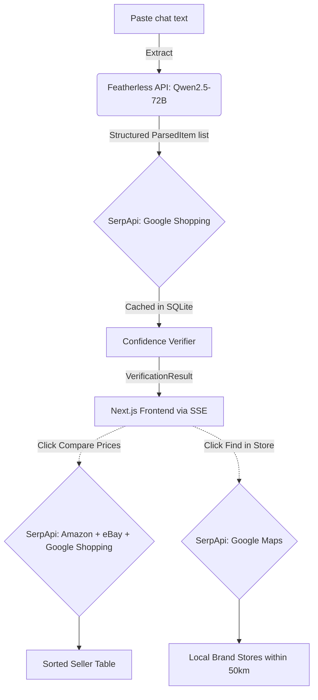

# Paste-to-Product

**Paste any AI style advice chat → get real, buyable products with confidence scores and cross-platform price comparison.**

Built for the [SerpApi Hackathon](https://serpapi.com) in the General Track.

*Note: this is built in this hackathon period.

---

## The Problem

AI chatbots give great style advice but leave you to do all the shopping yourself. They say "white leather sneakers" — you spend 40 minutes on Google, unsure whether what you found actually matches.

## The Solution

Paste the AI chat here. We:
1. **Extract** every shoppable item (powered by Qwen2.5-72B-Instruct via Featherless API).
2. **Find** real products via Google Shopping (SerpApi).
3. **Score** every result with a per-attribute confidence breakdown (Exact / Variant / Best match).
4. **Compare prices** across Google Shopping, Amazon, and eBay — without duplicating API calls.
5. **Find locally** via Google Maps, filtering strictly by brand within a 50 km radius.

---

## Demo

- **Video:** https://youtu.be/2TrHVOB3AkQ


### Screenshots
*(See `docs/images/` for full-resolution screenshots)*
- **Home & Intake:** `docs/images/home_intake.png`
- **Results with Confidence Scores:** `docs/images/results_scores.png`
- **Compare Prices:** `docs/images/compare_prices.png`
- **Offline Map:** `docs/images/offline_map.png`

---

## How It Works



See [ARCHITECTURE.md](docs/ARCHITECTURE.md) for more details.

---

## SerpApi Usage

| Engine | Purpose | Where in code |
|--------|---------|---------------|
| `google_shopping` | Main product discovery | `backend/app/finder.py` |
| `amazon` | Search Amazon products | `backend/app/compare.py` |
| `ebay` | Search eBay listings | `backend/app/compare.py` |
| `google_immersive_product` | Deep product detail from Shopping result | `backend/app/compare.py` |
| `google_maps` | Find local brand stores | `backend/app/finder.py` |

**Credit Use:**
- We aggressively cache all responses in SQLite. Identical requests across sessions consume zero API credits.
- Searches target selected items only to avoid waste.
- **Session cap:** 50 calls max.
- **Offline mode:** Hard cap of 30 Maps calls per offline search.

---

## Setup

Follow these steps to run a clean clone.

### Prerequisites

- Python 3.12+
- Node.js 18+
- SerpApi API key → [serpapi.com](https://serpapi.com)
- Featherless API key (for Qwen2.5-72B parsing)

### Backend

```bash
cd backend
python -m venv .venv
# Windows: .venv\Scripts\activate
# Mac/Linux: source .venv/bin/activate

pip install -r requirements.txt

cp .env.example .env
# Edit .env with your SerpApi and Featherless keys
```

Start the backend:
```bash
uvicorn app.main:app --reload --port 8000
```

Run tests:
```bash
pytest
```

### Frontend

In a new terminal:
```bash
cd frontend
npm install
npm run dev
# Open http://localhost:3000
```

### Demo Mode

To run without making live API calls (ideal for presentations):
1. In the `backend` directory, ensure your real `SERPAPI_API_KEY` is set.
2. Run `python scripts/cache_demo_data.py`. This pre-populates the SQLite cache.
3. Edit `.env` and set `DEMO_MODE=true`.

---

## Browser Extension

The [Paste-to-Product browser extension](extension/README.md) allows you to copy an open ChatGPT conversation into the site and start a search with one click. It is a convenience layer—all product searches still run through SerpApi on the site backend.

---

## Limitations

- **Offline Mode Shelves:** Offline mode finds brand stores but cannot see live inventory on the shelves.
- **Verification Confidence:** Verification scoring provides a calculated confidence score based on title and attribute matching; it is not absolute certainty.
- **Caching:** Caching works on a normalised request basis. Dynamic parameter changes might miss the cache.
- **Extension Dependency:** The browser extension relies on the current DOM structure of ChatGPT; it may break if OpenAI updates their interface.

---

## Evaluation Numbers

- **Offline Mode Precision:** 83.3% of returned pins are correct stores within 50 km.
- **Offline Mode Coverage:** 80% of queries return valid stores; 20% accurately display a "No stores" empty state.
- **Offline Cost:** Strictly constrained to 30 Maps credits per request. Negative caching ensures duplicate searches cost zero credits.
*(Measured using the `eval/run_eval.py` harness across 20 test chats and verified in `docs/EVAL_OFFLINE_V2.md`)*

---

## Built With

- **Backend:** Python, FastAPI, SQLite
- **Frontend:** Next.js (App Router), React, CSS Modules
- **LLM Provider:** Qwen2.5-72B-Instruct via Featherless AI (for structured item parsing)
- **AI Tools Used:** Cursor (code generation), Claude 3.5 Sonnet (architecture and review), Google Gemini/Antigravity (repository refinement). *(Owner to confirm final AI tools list).*

---

## Project Structure

```text
serpapi/
├── backend/          # FastAPI backend, SerpApi client, SQLite cache
├── frontend/         # Next.js UI, SSE streaming components
├── extension/        # Chrome extension for ChatGPT handoff
├── docs/             # Architecture, decisions, evaluations
└── eval/             # Evaluation scripts and test chats
```

## License and Author

**Author:** Raj
**License:** MIT License
