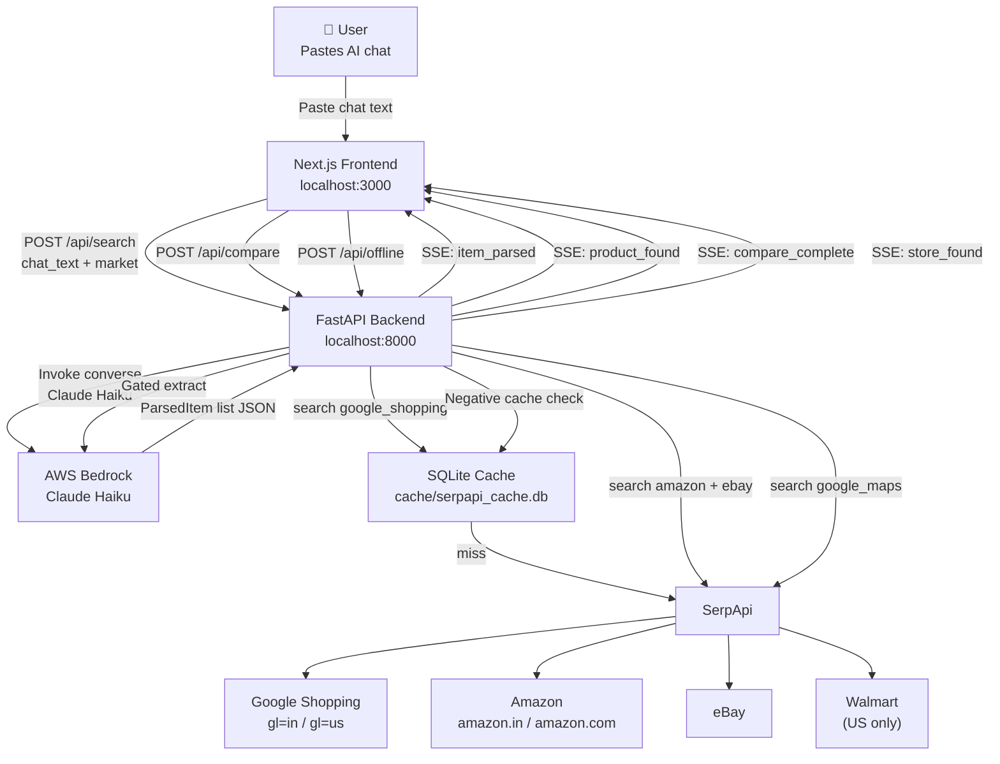

# Architecture — Paste-to-Product

## System Overview



## Component Responsibilities

### `cache.py` — SerpApiCache
- SQLite-backed key-value store
- Keys: SHA-256 of `{engine, sorted_params}`
- Strips `api_key` from cache key (security)
- Thread-safe via `check_same_thread=False`

### `serpapi_client.py` — SerpApiClient
- Async HTTP client (httpx)
- Cache-first: always check SQLite before making a live call
- Call cap enforced before every live request
- Demo mode: raises on cache miss instead of going live
- Full call log for the trace panel

### `parser.py` — Chat Parser
- AWS Bedrock via `boto3.client("bedrock-runtime").converse()`
- Prompt in `prompts/parse_chat.txt` (versioned)
- Prefill `{` forces Claude to output clean JSON
- Graceful degradation: malformed items skipped, empty input returns empty list

### `finder.py` — Product Finder
- Single Google Shopping call per `ParsedItem`
- Market-aware: `gl=in` + `google_domain=google.co.in` for India
- Returns top 10 `ProductCandidate` objects

### `verifier.py` — Confidence Scorer
- Pure Python — no LLM, no API call
- Per-attribute title matching with synonym expansion
- Labels: `Exact` (brand+model matched), `Variant` (brand only), `Best match to your description` (generic)
- Price band check against `budget_hint`

### `compare.py` — Price Comparator
- 3 engines for India: Google Shopping, Amazon, eBay
- 4 engines for US: + Walmart
- Top 3 results per platform
- Filters by `overall_confidence >= 0.4`
- Sorts by `extracted_price` ascending

### `api.py` — SSE Endpoints
- `POST /api/search`: parse → find → verify → stream
- `POST /api/compare`: multi-platform search → stream
- `POST /api/offline`: brand extraction → google maps search → progressive stream
- Uses `sse-starlette` for Server-Sent Events
- Event types: `trace`, `item_parsed`, `product_found`, `compare_complete`, `store_found`, `offline_complete`, `error`, `complete`

### `store_finder_v2.py` — Offline Brand Search
- 3-tier gated search enforcing a strict 30-credit budget.
- Tier 3: Category sweep based on audience (e.g. "men's clothing store").
- Tier 2: Multi-brand chain search (e.g. "Lifestyle store") verified by matcher.
- Tier 1: Extract genuine brands using LLM, filter out marketplaces (Myntra, Ajio), then search brand stores.
- `BrandLogDB`: SQLite table acting as negative cache for 10x10km cells to avoid repeating zero-result searches.

## Data Models

```
ParsedItem
  category, colour, fit_style, material, gender,
  budget_hint, season, brand, model_name,
  is_specific, source_text, search_query

ProductCandidate
  title, price, extracted_price, currency,
  source, link, thumbnail, rating, reviews,
  product_id, engine_used, position

AttributeScore
  attribute, match, confidence, evidence

VerificationResult
  overall_confidence, scores, label

CompareOffer
  platform, seller, price, extracted_price, currency,
  link, verified, verification, shipping_info
```

## SSE Event Flow

```
POST /api/search
  → trace {agent: "parser", status: "running"}
  → trace {agent: "parser", status: "complete", n_items}
  → item_parsed × N
  → trace {agent: "finder", status: "running"} × N
  → product_found {item, results[{candidate, verification}]} × N
  → complete {total_items, serpapi_calls}

POST /api/compare
  → trace {agent: "compare-prices", status: "running"}
  → trace {agent: "compare-prices", status: "complete"}
  → compare_complete {offers, cheapest_index, search_engines_used}
```

## Caching Strategy

All SerpApi responses are cached indefinitely in SQLite. The cache key is the SHA-256 hash of the normalised `{engine, sorted_params}` JSON. The `api_key` is stripped before hashing.

This means:
- Identical searches within or across sessions are served from cache
- Demo mode uses only the cache — no live calls
- The 50-call session cap only counts live (non-cached) calls
